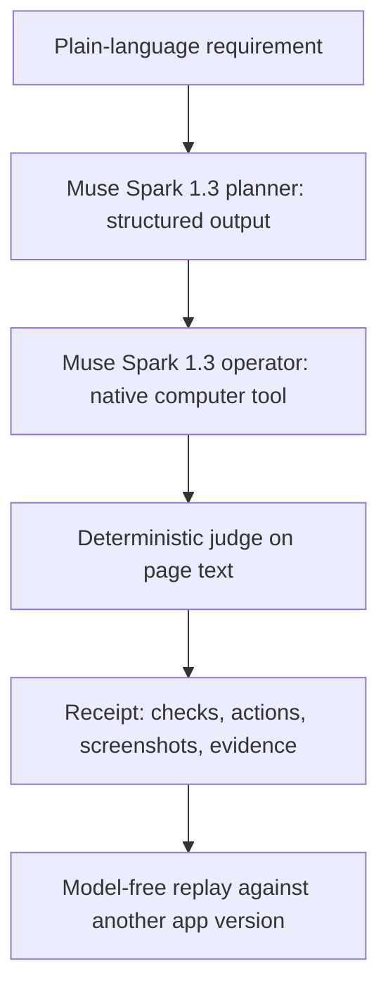

Plainproof turns a plain-language requirement into a browser test, a code-decided verdict, and an inspectable receipt that can be replayed without a model.

People who direct AI coding agents often cannot audit the generated code, but they can state what the app must do. Plainproof lets them check that behavior in the running app and inspect the evidence before accepting a change.

The requirement becomes a test through two uses of the Meta Model API: Muse Spark 1.3 produces a structured plan, then operates the app through screenshots and the native computer tool.



The planner uses Responses API structured output (`text.format`, strict JSON schema). Local validation rejects malformed or unsupported plans. The operator sends native `computer` actions; the harness executes them in Playwright and returns screenshots with matching call IDs, conversation continuity, and any approved safety acknowledgements. The web UI streams screenshots and executed steps. The receipt records the plan, actions, safety decisions, page-text checkpoints, evidence snippets, model usage, elapsed time, and estimated cost.

Code decides the verdict. The model's final claim cannot override it. Checks compare literal, case-sensitive substrings of `document.body.innerText`: visible, absent, or an exact occurrence count. Reload checks evaluate every operator reload and the independent audit reload; end checks evaluate both the end state and that audit. Missing coverage or unfinished runs are INCONCLUSIVE. A normal completed run with coverage and passing checks is PASS; a failed check makes it FAIL.

A fresh marker identifies the item created for each run. After every executed action batch, the harness stores a `marker_seen` boolean, without adding page text to the step. If the resolved task contains that marker but no step or checkpoint ever saw it, the judge returns **INCONCLUSIVE**, with **`marker_never_seen`** displayed in the receipt. This prevents an untouched empty list from passing an add-then-delete test just because the item is absent and the counter already says zero. Replay remeasures visibility and applies the same guard. Safety stops and runtime errors retain their distinct verdicts.

The planner chooses the checks, and a weak plan remains possible. Both the original and resolved plan, the selected checks, and the marker evidence are visible in the receipt. A PASS supports those recorded checks on that trajectory; it is not a proof of every interpretation of the requirement.

Each run uses a sandboxed headless browser with a fresh context. Browser HTTP(S) and WebSocket requests are restricted to the app's origin; service workers are blocked, downloads are disabled, extra pages are closed, and dialogs are dismissed. Generic `computer_action_requires_confirmation` checks are acknowledged only with the explicit `--approve-confirmations` flag (or the UI checkbox), and only on the exact local app entry page or its `index.html`. Any other safety check stops the run before the associated actions. This browser boundary is not a hardened VM for hostile applications. The credential comes only from the process environment, `MODEL_API_KEY`; there is no credential field in the UI. The UI binds to loopback and rejects foreign Host/Origin requests.

Measured results below are real Meta Model API runs from **Oct 27, 2026**, using **muse-spark-1.3 as planner and operator**, with **generic confirmations acknowledged**. They were taken before the marker guard was added; see the limits below for how the guard was checked.

| Requirement | App variant | Verdict | Time | Cost |
| --- | --- | --- | --- | --- |
| New to-do still listed after reload | bug_reload | FAIL | 55 s | $0.038 |
| same | correct | PASS | 41 s | $0.030 |
| Counter drops to 0 after marking done | bug_counter | FAIL | 65 s | $0.048 |
| same | correct | PASS | 35 s | $0.029 |
| same, typed in the web UI | bug_counter | FAIL | 102 s | $0.072 |
| Add then delete; gone and 0 items left (new requirement typed in the web UI) | correct | PASS | 64 s | $0.047 |
| Replay of the bug_reload receipt against correct | correct | PASS | 1.3 s | $0 (zero model calls) |

Quick start requires **Python 3.12+**, `openai`, `playwright`, and the standard library, plus Playwright's Chromium and its system libraries.

```sh
python3 -m venv .venv
. .venv/bin/activate
python -m pip install -r requirements.txt
python -m playwright install --only-shell chromium
# Linux, if browser system libraries are missing:
python -m playwright install-deps chromium
```

Start with the offline mock. It makes no API calls and uses the local demo apps:

```sh
python -m plainproof check --app-dir demo_app/bug_counter \
  --requirement 'After I add one to-do and mark it done, the counter decreases to 0 items left.' \
  --out runs/offline-before --mock
# Expected FAIL (exit code 1). Then run:
python -m plainproof replay runs/offline-before \
  --app-dir demo_app/correct --out runs/offline-after
# Expected PASS, zero model calls and $0.
```

Inspect `runs/offline-before/receipt.html` and `runs/offline-after/receipt.html`; each HTML receipt embeds its screenshots and can be opened directly. Replay uses recorded executed actions and checks in a fresh browser context, with no API credential required. Use a fresh, empty output directory for each run. PASS exits 0, FAIL exits 1, and other verdicts exit 2.

For a real run, supply `MODEL_API_KEY` through your environment or secret manager before starting the process. No real API call is needed for the offline examples or tests.

```sh
python -m plainproof check --app-dir demo_app/bug_counter \
  --requirement 'After I add one to-do and mark it done, the counter decreases to 0 items left.' \
  --out runs/live-before --model muse-spark-1.3 --approve-confirmations

python -m plainproof serve --port 8765 --out runs/web
# Open http://127.0.0.1:8765
```

In the UI, choose an app, type a requirement, keep Muse Spark 1.3 selected, uncheck **Offline demo**, enable **Approve generic computer confirmations for this local app only**, and press **Run proof**. Screenshots and steps stream, then **Open receipt** appears. Replay currently uses the CLI; the UI has no replay button. `--app-url` can replace `--app-dir` for a running app. Defaults are 25 steps and 180 seconds per run.

Run all offline tests with:

```sh
python -m tests.run_tests
python day1_minimal/test_offline.py
```

The main suite forbids construction of a real API client and includes the no-op delete regression, normal add-then-delete, and replay guard checks. The archived day-1 suite is separate. Mock plans recognize a few demo scenarios; they do not demonstrate general model ability.

Honest limits and account observations:

- On my account on Oct 27, 2026, the native computer tool returned HTTP 400, `"Unsupported tool type: 'computer'"`, for `muse-wonder-1.0`, while `muse-spark-1.3` accepted it. Muse Spark 1.3 is therefore the operator; Wonder stays selectable.
- In these measurements, `muse-spark-1.3` attached `computer_action_requires_confirmation` to every action. The local opt-in policy above was enabled.
- One run hit HTTP 500 mid-way. The client retries 5xx twice; an unrecovered error retains the evidence and produces ERROR.
- The planner chooses the checks, so weak coverage remains possible. The marker guard establishes a sighting, not the full causal sequence. An add and delete within one batch can be missed if no checkpoint observes the marker; the conservative result is INCONCLUSIVE.
- Page-text checks do not establish hidden state, checkbox semantics, styling, or backend correctness. Audit reload checks persistence of the recorded final state.
- Replay repeats coordinates and does not adapt to layout or timing changes. The source receipt's SHA-256 records provenance, not a tamper-proof signature.
- Receipts include app content and screenshots. Use synthetic data and review artifacts before sharing. Costs are estimates from reported token usage, not billing reconciliation.
- The marker guard was added after the measurements above. It is covered by the offline tests and by one real add-then-delete run on Oct 27 (PASS, marker seen after action batch 3 of 4 and gone at the end, 63 s, $0.040).

Everything in this repository was built during the **Meta Global AI Developer Hackathon**, building period **Oct 27–Nov 4, 2026**, for **“Push the Frontier” (software)**, with dated commits starting **Oct 27, 2026**. The day-1 harness is preserved in `day1_minimal/`; the current planner, operator, deterministic judge, marker guard, receipts, replay, local web UI, demo apps, and offline tests are in this repository. [DEMO_SCRIPT.md](DEMO_SCRIPT.md) shows how to film the implemented workflow. Muse Code fixing an app from a failing receipt is **next**, and is not built yet.

Credits: **Meta Model API** for planning and native computer use; **Playwright** for browser execution and evidence capture. Code was drafted with AI coding assistants and reviewed and measured by me.
