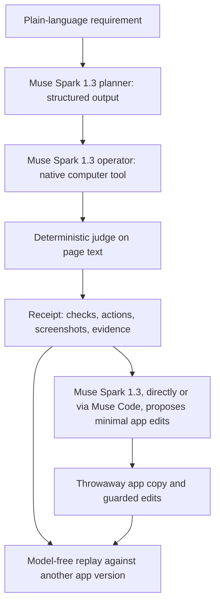

Plainproof turns a plain-language requirement into a browser test, a code-decided verdict, and an inspectable receipt that can be replayed without a model. When a check fails, Muse Spark 1.3 (directly, or through Meta's Muse Code agent) proposes a fix, and the fix is accepted only if the same recorded path passes again with zero model calls. Muse Spark 1.3 also plans each test and operates the app through Meta's native computer tool. On real Meta Model API runs, both one-line bugs planted in the demo to-do app were caught, and every measured repair of them was accepted (see Measured results).

People who direct AI coding agents often cannot audit the generated code, but they can state what the app must do. Plainproof lets them check that behavior in the running app and inspect the evidence before accepting a change.

## How it works

The requirement becomes a test through two uses of the Meta Model API: Muse Spark 1.3 produces a structured plan, then operates the app through screenshots and the native computer tool.



The planner uses Responses API structured output (`text.format`, strict JSON schema). Local validation rejects malformed or unsupported plans. The operator sends native `computer` actions; the harness executes them in Playwright and returns screenshots with matching call IDs, conversation continuity, and any approved safety acknowledgements. The web UI streams screenshots and executed steps. The receipt records the plan, actions, safety decisions, page-text checkpoints, evidence snippets, model usage, elapsed time, and estimated cost.

## How the verdict is decided

Code decides the verdict. The model's final claim cannot override it. Checks compare literal, case-sensitive substrings of `document.body.innerText`: visible, absent, or an exact occurrence count. Reload checks evaluate every operator reload and the independent audit reload; end checks evaluate both the end state and that audit. Missing coverage or unfinished runs are INCONCLUSIVE. A normal completed run with coverage and passing checks is PASS; a failed check makes it FAIL.

A fresh marker identifies the item created for each run. After every executed action batch, the harness stores a `marker_seen` boolean, without adding page text to the step. If the resolved task (the plan with this run's fresh marker filled in) contains that marker but no step or checkpoint ever saw it, the judge returns **INCONCLUSIVE**, with **`marker_never_seen`** displayed in the receipt. This prevents an untouched empty list from passing an add-then-delete test just because the item is absent and the counter already says zero. Replay remeasures visibility and applies the same guard. Safety stops and runtime errors retain their distinct verdicts.

The planner chooses the checks, and a weak plan remains possible. Both the original and resolved plan, the selected checks, and the marker evidence are visible in the receipt. A PASS supports those recorded checks on that trajectory; it is not a proof of every interpretation of the requirement.

## Safety boundary

Each run uses a sandboxed headless browser with a fresh context. Browser HTTP(S) and WebSocket requests are restricted to the app's origin; service workers are blocked, downloads are disabled, extra pages are closed, and dialogs are dismissed. Generic `computer_action_requires_confirmation` checks are acknowledged only with the explicit `--approve-confirmations` flag (or the UI checkbox), and only on the exact local app entry page or its `index.html`. Any other safety check stops the run before the associated actions. This browser boundary is not a hardened VM for hostile applications. Credentials come only from the process environment: the planner, operator and Spark fixer read `MODEL_API_KEY`, and the optional Muse Code fixer requires `META_API_KEY`, the variable the `muse` CLI itself reads. There is no credential field in the UI. The UI binds to loopback and rejects foreign Host/Origin requests.

## Measured results

Measured results below are real Meta Model API runs. The check rows are from **Oct 27, 2026** and use **muse-spark-1.3 as planner and operator**, with **generic confirmations acknowledged**. The repair rows are from Oct 29 and Nov 1, 2026 (Japan time) and use the fixer named in the row; their acceptance replay makes no model calls. The check rows (Oct 27) were taken before the marker guard was added; the repair rows were taken after it, and their replays include the guard. See the limits below for how the guard was checked on a check run.

| Requirement | App variant | Verdict | Time | Cost |
| --- | --- | --- | --- | --- |
| New to-do still listed after reload | bug_reload | FAIL | 55 s | $0.038 |
| same | correct | PASS | 41 s | $0.030 |
| Counter drops to 0 after marking done | bug_counter | FAIL | 65 s | $0.048 |
| same | correct | PASS | 35 s | $0.029 |
| same, typed in the web UI | bug_counter | FAIL | 102 s | $0.072 |
| Add then delete; gone and 0 items left (new requirement typed in the web UI) | correct | PASS | 64 s | $0.047 |
| Replay of the bug_reload receipt against correct | correct | PASS | 1.3 s | $0 (zero model calls) |
| Repair: Muse Spark 1.3 proposes a fix from the bug_reload FAIL receipt, replay on the patched copy | bug_reload | FIXED 2/2 | 5.5-6.1 s | $0.005-0.006 |
| Repair: same, from the bug_counter FAIL receipt | bug_counter | FIXED 2/2 | 4.3-4.7 s | $0.0025-0.0057 |
| Repair: Muse Code (headless `muse exec`, muse-spark-1.3) edits the copy from the bug_reload FAIL receipt | bug_reload | FIXED 2/2 | 40-86 s | $0.060-0.092 |
| Repair: Muse Code, from the bug_counter FAIL receipt | bug_counter | FIXED 2/2 | 60-61 s | $0.079-0.084 |

One more Muse Code repair of bug_reload on Nov 1, run before usage parsing was added, was also FIXED (42 s); its cost was not recorded, so it is not in the table. The check rows are the main runs; all completed Oct 27 check runs, including the day-1 harness and the demo recordings, took 34-118 s and $0.024-0.072.

## Quick start (offline, no API key)

Quick start requires **Python 3.12+**, `openai`, `playwright`, and the standard library, plus Playwright's Chromium and its system libraries.

```sh
python3 -m venv .venv
. .venv/bin/activate
python -m pip install -r requirements.txt
python -m playwright install --only-shell chromium
# Linux, if browser system libraries are missing:
python -m playwright install-deps chromium
```

Start with the offline mock. It makes no API calls and uses the local demo apps:

```sh
python -m plainproof check --app-dir demo_app/bug_counter \
  --requirement 'After I add one to-do and mark it done, the counter decreases to 0 items left.' \
  --out runs/offline-before --mock
# Expected FAIL (exit code 1). Then run:
python -m plainproof replay runs/offline-before \
  --app-dir demo_app/correct --out runs/offline-after
# Expected PASS, zero model calls and $0.
```

Inspect `runs/offline-before/receipt.html` and `runs/offline-after/receipt.html`; each HTML receipt embeds its screenshots and can be opened directly. Replay uses recorded executed actions and checks in a fresh browser context, with no API credential required. Use a fresh, empty output directory for each run. PASS exits 0, FAIL exits 1, and other verdicts exit 2.

## Repair loop

Repair with **Muse Spark 1.3** is the default: a FAIL receipt supplies the requirement, resolved plan, failing evidence, recorded actions, final failing screenshot and app files. Spark proposes a small structured edit. Plainproof validates all edits before applying any, then replays the same recorded actions and checks, including the marker guard, against a throwaway `patched_app/`. **That replay decides acceptance and makes zero model calls. The original app is never modified.** A FIXED result supports the recorded path; it does not establish general correctness.

```sh
python -m plainproof repair runs/offline-before --app-dir demo_app/bug_counter \
  --out runs/offline-repair --mock
# Expected FIXED (exit 0). Open runs/offline-repair/repair.html.
```

For a real repair, omit `--mock` and supply `MODEL_API_KEY` in the environment. The default fixer/model is `spark` / `muse-spark-1.3`. `--fresh-check --approve-confirmations` optionally runs a separate fresh planner/operator check after FIXED; its verdict is recorded as `fresh_check_verdict` and does not replace the replay verdict. In the web UI, a FAIL reveals **Propose a fix**, which streams repair status and shows the banner, colored diff, and receipt links for that run's app variant and offline setting.

Only existing UTF-8 `.html`, `.js`, `.css`, `.json` and `.txt` files are supported, with a 2 MB (2,000,000 byte) total limit. Symlinks, special files and unsupported files are refused. Repairs use 1–5 uniquely matched replacements, at most 4,000 characters each. Use exactly the app directory used for the source run; existing receipts do not fingerprint app files. Outputs include `repair.json`, `repair.html`, `repair.diff`, `patched_app/` and `replay/receipt.html`. FIXED exits 0, NOT_FIXED exits 1; INCONCLUSIVE, REPAIR_REJECTED and ERROR exit 2. Repair measurements (Oct 29, 2026, real Meta Model API) are in the results table. The demo bug variants contain no comments that point at the bug; each differs from `correct` by one line of code (shown in the repair diffs).

**Muse Code as the fixer is optional and not enabled by default.** `--fixer muse-code` requires the `muse` CLI on PATH (Meta's official installer; Plainproof installs nothing) and `META_API_KEY` from the environment. The adapter runs headless `muse exec --json` with the throwaway copy as its workspace and gives the agent file tools only: shell and web tools are disabled, user prompts are withheld, other agents' personal rule files are excluded (`--no-foreign-personal-context`), approvals stay at the default, and the sandbox stays on with restricted networking. It never uses `--yolo`, `--disable-approval` or `--disable-sandbox`. Plainproof audits the changed files, and the zero-call replay still decides. Token usage and cost come from the CLI's `run.usage` event when every call used the selected model; otherwise they are recorded as unknown. In the real runs (Nov 1, 2026, Muse Code 1.4.14) Muse Code made the same one-line fixes as the Spark fixer; it read the file, edited it and, in 3 of 4 runs, read it again, over 4-5 model calls, so each repair took longer and cost more. See the [headless protocol](https://dev.meta.ai/docs/muse-code/extending.md), [authentication](https://dev.meta.ai/docs/muse-code/auth.md), and [permissions](https://dev.meta.ai/docs/muse-code/permissions.md). This experimental integration is not a hardened VM for hostile code.

## Real runs and the web UI

For a real run, supply `MODEL_API_KEY` through your environment or secret manager before starting the process. No real API call is needed for the offline examples or tests.

```sh
python -m plainproof check --app-dir demo_app/bug_counter \
  --requirement 'After I add one to-do and mark it done, the counter decreases to 0 items left.' \
  --out runs/live-before --model muse-spark-1.3 --approve-confirmations

python -m plainproof serve --port 8765 --out runs/web
# Open http://127.0.0.1:8765
```

In the UI, choose an app, type a requirement, keep Muse Spark 1.3 selected, uncheck **Offline demo**, enable **Approve generic computer confirmations for this local app only**, and press **Run proof**. Screenshots and steps stream, then **Open receipt** appears. A FAIL also offers **Propose a fix**. Standalone replay uses the CLI; repair invokes replay automatically. `--app-url` can replace `--app-dir` for checks and standalone replays; repair requires `--app-dir`. Defaults are 25 steps and 180 seconds per run.

## Tests

Run all offline tests with:

```sh
python -m tests.run_tests
python day1_minimal/test_offline.py
```

The main suite forbids construction of a real API client in integration tests and includes the no-op delete regression, normal add-then-delete, replay guard checks, both demo repairs, rejected/ineffective repairs, original-file integrity, CLI exit codes and the rendered web repair flow. The automated suite tests the Muse Code adapter with a fake local executable (flags, usage parsing, file audits); the real Muse Code runs are in the results table. The archived day-1 suite is separate. Mock plans recognize a few demo scenarios; they do not demonstrate general model ability. Set `PLAINPROOF_TEST_OUT` to put the main suite's artifacts outside `test-artifacts/` (the selected directory is replaced on each run).

## Limits and account observations

- On my account on Oct 27, 2026, the native computer tool returned HTTP 400, `"Unsupported tool type: 'computer'"`, for `muse-wonder-1.0`, while `muse-spark-1.3` accepted it. Muse Spark 1.3 is therefore the operator; Wonder stays selectable.
- In these measurements, `muse-spark-1.3` attached `computer_action_requires_confirmation` to every action. The local opt-in policy above was enabled.
- One check run on Oct 27 stopped at step 2 on an HTTP 500, before retries were added, and did not count as a pass. The client now retries 5xx twice; an unrecovered error retains the evidence and produces ERROR.
- One demo-recording run hit the 180 s time budget and was INCONCLUSIVE. The web server now takes `--timeout-s` (the recording used 420 s).
- The planner chooses the checks, so weak coverage remains possible. The marker guard establishes a sighting, not the full causal sequence. An add and delete within one batch can be missed if no checkpoint observes the marker; the conservative result is INCONCLUSIVE.
- A fix could make the checked text appear without fixing other behavior; FIXED supports only the recorded path, so the diff is kept for review.
- Page-text checks do not establish hidden state, checkbox semantics, styling, or backend correctness. Audit reload checks persistence of the recorded final state.
- Replay repeats coordinates and does not adapt to layout or timing changes. The source receipt's SHA-256 records provenance, not a tamper-proof signature.
- Receipts include app content and screenshots. Use synthetic data and review artifacts before sharing. Costs are estimates from reported token usage, not billing reconciliation.
- The marker guard was added after the Oct 27 check rows above; the repair rows came later and their replays include it. It is covered by the offline tests and by one real add-then-delete run on Oct 27 (PASS, marker seen after action batch 3 of 4 and gone at the end, 63 s, $0.040).

## Built during the hackathon

Everything in this repository was built during the **Meta Global AI Developer Hackathon**, building period **Oct 27–Nov 4, 2026**, for **“Push the Frontier” (software)**, with dated commits starting **Oct 27, 2026**. The day-1 harness is preserved in `day1_minimal/`; the current planner, operator, deterministic judge, marker guard, receipts, replay, local web UI, demo apps, offline tests and repair with Muse Spark 1.3 are in this repository. [DEMO_SCRIPT.md](DEMO_SCRIPT.md) shows how to film the implemented workflow. Muse Code as the fixer is optional and not enabled by default.

Credits: **Meta Model API** for planning and native computer use; **Playwright** for browser execution and evidence capture. Code was drafted with AI coding assistants and reviewed and measured by me.
